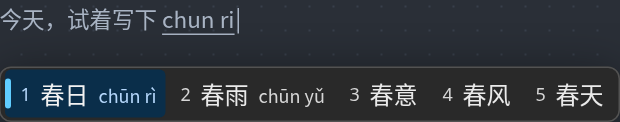

# Fluent 2 小狼毫皮肤

为 Windows 小狼毫输入法制作的 Fluent 2 风格皮肤。提供浅色与深色配色，以中性浮层、蓝色选中态、圆角和阴影呈现候选窗口。

皮肤以一份 `weasel.custom.yaml` 分发，可直接安装。仓库附带本地预览工具，供开发者和 agent 检查修改后的效果。

## 预览

| 浅色 | 深色 |
| --- | --- |
|  |  |

图片来自 Linux Chromium 浏览器仿真，使用字体回退。Windows 字体与原生绘制效果可能不同，当前尚未完成 Windows 发布验收；详见[兼容情况](docs/compatibility.md)。

## 安装

需要先安装 Windows 小狼毫输入法。安装皮肤无需 Node.js、pnpm 或预览工具。

1. 打开[皮肤配置](skins/fluent-2/weasel.custom.yaml)，点击 GitHub 文件页面的 **Download raw file**，保存为 `weasel.custom.yaml`。
2. 右键小狼毫托盘图标，打开「用户文件夹」。
3. 将文件放入用户文件夹。如果已有同名文件，先备份，再将皮肤配置的条目合并到现有的 `patch` 字典中；保留一个顶层 `patch`，并处理同名样式与配色条目。
4. 从小狼毫托盘菜单执行「重新部署」。

### 配色与字体

配置默认使用 `fluent_light`，在系统深色模式下使用 `fluent_dark`。在现有 `patch` 的 `style/+` 字典中调整以下值即可切换：

| 外观 | `color_scheme` | `color_scheme_dark` |
| --- | --- | --- |
| 随系统切换（默认） | `fluent_light` | `fluent_dark` |
| 固定浅色 | `fluent_light` | `fluent_light` |
| 固定深色 | `fluent_dark` | `fluent_dark` |

中文字体优先使用 Microsoft YaHei UI / Microsoft YaHei，序号优先使用 Segoe UI。修改配色、字体或布局后，需要再次「重新部署」。

## 开发皮肤

需要 Node.js **22.12+** 和 pnpm **11.26.0**。克隆仓库并启动预览：

```bash
git clone https://github.com/oolongcha024/weasel-fluent-skin.git
cd weasel-fluent-skin
pnpm install
pnpm dev
```

打开终端显示的访问地址，编辑 [skins/fluent-2/weasel.custom.yaml](skins/fluent-2/weasel.custom.yaml) 即可实时预览。默认仅本机访问，端口自动分配；远程开发通过 `--host` 指定监听地址，需要固定端口时使用 `--port`，详见[开发说明](docs/development.md#监听地址与端口)。场景由 [previews/scenes.json](previews/scenes.json) 定义，覆盖日常输入、长词与混排、特殊字符。

生成浅色、深色与全部场景的检查产物：

```bash
pnpm browser:install # 首次使用时安装 Chromium
pnpm capture --dpr 1.5
```

每次运行在 `artifacts/` 中保存独立的截图、HTML、配置快照和结构化绘制报告，便于人工与 agent 检查。工具只读取文件；Windows 上的皮肤部署仍需在小狼毫中执行。

## 文档

| 文档 | 内容 |
| --- | --- |
| [设计说明](docs/design.md) | 配色、字体、布局与 Fluent 2 风格的设计取舍 |
| [兼容情况](docs/compatibility.md) | 字体要求、缩放、预览限制与 Windows 实测状态 |
| [开发与发布](docs/development.md) | 测试命令、截图检查和发布流程 |
| [预览工具](tools/preview/README.md) | 命令参数、自动化入口、实现与原生布局对照 |
| [官方定制文档](docs/weasel-official/README.md) | 小狼毫官方 Wiki 的本地快照 |

## 反馈与贡献

遇到问题或有改进建议，可以[提交 Issue](https://github.com/oolongcha024/weasel-fluent-skin/issues)。反馈显示问题时，请附上小狼毫版本、Windows 版本、显示缩放、所用字体、复现步骤和截图，并说明问题发生在原生小狼毫还是浏览器预览中。

欢迎提交 Pull Request 改进皮肤、文档或预览工具。开始前请阅读[设计说明](docs/design.md)和[开发与发布](docs/development.md)，修改皮肤后检查浅色、深色及各个预览场景。

由 [oolongcha024](https://github.com/oolongcha024) 维护。

## 许可

本项目自有皮肤与代码使用 [MIT 许可](LICENSE)。预览工具内的[官方默认配置快照](tools/preview/data/README.md)保留其上游许可与作者信息。
